 <div align="center">

# 🎀 Hi, I'm Ana! 💗

### ✨ B.Tech CSE (Cybersecurity) Student • Cybersecurity Enthusiast • Developer ✨


🌸 *code, curiosity & a little bit of pink* 🌸

</div>

---

## 💗 About Me

```python
class Ana:
    def __init__(self):
        self.role = "B.Tech CSE - Cybersecurity Student 🎓"

        self.skills = [
            "Python 🐍",
            "C Programming 💻",
            "Linux 🐧"
        ]

        self.interests = [
            "Cybersecurity 🔐",
            "Ethical Hacking 🛡️",
            "Web Application Security 🌐",
            "Networking 📡",
            "Problem Solving 🧠"
        ]

        self.currently_learning = (
            "exploring vulnerabilities, building security projects "
            "and understanding how to secure systems ✨"
        )

        self.goal = "Become a skilled Cybersecurity Professional 🚀"

    def say_hi(self):
        print("Thanks for visiting my GitHub! 🎀")


me = Ana()
me.say_hi()
```

---

## 🎀 What I'm Up To

🌷 Exploring **Cybersecurity & Ethical Hacking**

🔐 Learning **Web Application Penetration Testing**

🐧 Practicing with **Linux & Kali Linux**

🌐 Exploring **Computer Networks & Vulnerability Assessment**

💻 Improving my **Python, C & DSA Skills**

🧪 Building hands-on **Cybersecurity Projects and Labs**

🛡️ Exploring **Buffer Overflow Vulnerabilities & Mitigation**

✨ Documenting my learning journey through GitHub

---

## 💻 My Tech Stack

### 🎀 Programming Languages


### 🐧 Operating Systems


### 🔐 Cybersecurity & Tools


### 💻 Development & Platforms


---

## 🔐 Cybersecurity Corner

```text
┌──(ana㉿kali)-[~/cybersecurity]
└─$ whoami

🎀 Computer Science Student
🔐 Cybersecurity Enthusiast
🐧 Linux Explorer
🌐 Web Security Learner
🛡️ Ethical Hacking Enthusiast
💻 Python & C Programmer
🌸 Professional Bug Creator
✨ Future Bug Fixer
```

> 💗 Learning security ethically — understand vulnerabilities, test responsibly, and build safer systems.

---

## 🌸 Current Learning Quest

```text
Cybersecurity          ████████░░  Exploring 🔐
Linux                  ████████░░  Hands-on 🐧
Networking             ███████░░░  Learning 🌐
Web Pentesting         ███████░░░  Practicing 🛡️
Python                 ████████░░  Building 🐍
C Programming          ████████░░  Improving 💻
DSA                    ███████░░░  Problem Solving 🧠
Coffee Consumption     ██████████  Critical ☕
```

---

<div align="center">

## 👾 My Contribution Arcade 🎀

*Pac-Man eating my contributions one commit at a time...* 💗

<br>

<picture>
  <source
    media="(prefers-color-scheme: dark)"
    srcset="https://raw.githubusercontent.com/anakabra16/anakabra16/gh-pages/pacman-contribution-graph-dark.svg"
  />
  <source
    media="(prefers-color-scheme: light)"
    srcset="https://raw.githubusercontent.com/anakabra16/anakabra16/gh-pages/pacman-contribution-graph.svg"
  />
  
</picture>

<br>

🌸 *feeding Pac-Man one commit at a time* 🌸

</div>

---

## 📊 GitHub Stats

<div align="center">


<br><br>


</div>

---

## 💕 Featured Projects

### 🔐 WAPT Phase 1 – Web Application Penetration Testing

Exploring web application security through practical exercises and documentation.

- Web Fundamentals
- Reconnaissance & Enumeration
- Burp Suite
- SQL Injection
- Cross-Site Scripting (XSS)
- Authentication Vulnerabilities
- Path Traversal & File Upload Vulnerabilities

### 🛡️ BufferGuard – Buffer Overflow Detection & Mitigation Framework

A cybersecurity project focused on demonstrating buffer overflow vulnerabilities in controlled programs and studying mitigation techniques.

- Stack Canaries
- ASLR
- NX/DEP
- Compiler-based Protections

### 🔍 IqraSec – Phase 2

Cybersecurity practical exercises, security testing, documentation and technical reporting.

### 💻 You Foodie – Restaurant Management System

A Python-based restaurant management application featuring menu management, order processing, billing, GST calculations and a user-friendly interface.

### 🐧 Linux & Cybersecurity Adventures

Documenting Linux fundamentals, Kali Linux commands, networking exercises, security tools and hands-on learning experiences.

> 🌷 *More projects loading... because apparently `git commit` doesn't do itself.*

---

## 🏆 Beyond the Keyboard

<div align="center">

🥋 **National-Level Karate Player**

🥇 **National President Cup Gold Medalist – 2026**

🏅 **Recognized as an Emerging Player by UPES**

*Discipline on the mat, curiosity behind the keyboard.*

</div>

---

<div align="center">

## 🌷 Let's Connect

💌 **[LinkedIn](https://www.linkedin.com/in/ana-kabra-543056377/)** • **[GitHub](https://github.com/anakabra16)**

<br>

### 💗 Thanks for stopping by!

```text
while(alive) {
    learn();
    code();
    explore();
    secure();
    improve();
}
```

✨ *stay curious • keep building • make it pretty* 🎀

<br><br>


</div>
